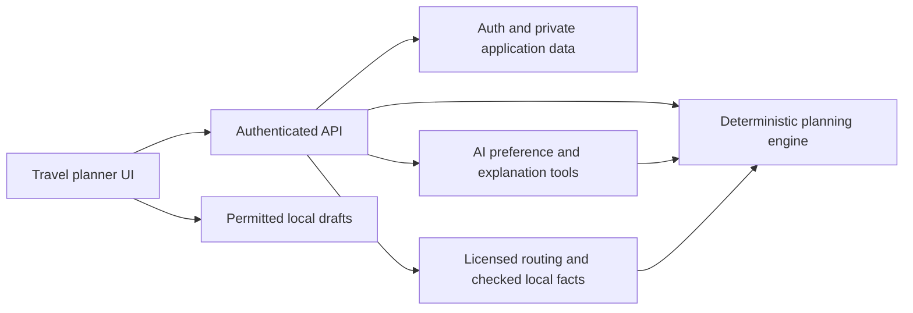

**Phase C — Technical design for the travel planning platform**

Version 1, researched 9 October 2026. This is an implementation blueprint following Phases A and B. Jaipur is the first dataset for evaluation; the product and core logic support adding other cities. No application code, paid account, cloud resource, or deployment is created in this phase. Provider behavior below is based on published documentation; account access and real-city accuracy still need testing.

**11. Recommended stack and boundaries**

Use a modular application with a managed database and authentication. Keep the scheduling engine independent of React, Firebase, maps, and the AI provider. A single API service is sufficient initially; avoid microservices, a separate recommendation service, and a multi-agent orchestration framework.

| Component | Recommendation | Reason and tradeoff |
| --- | --- | --- |
| Web interface | React + TypeScript + Vite | Responsive map/timeline UI with static deployment and shared domain types. Server-rendering is unnecessary for the private planning workspace; public discovery/SEO pages can be evaluated later |
| UI | Accessible native controls, reusable React components, CSS tokens | Small dependency surface and consistent mobile behavior. Keep labels, errors, keyboard focus, and readable evidence states explicit |
| API | Node.js + TypeScript + Fastify | Schema-validated boundaries and a familiar runtime for the solo developer; use trusted, version-controlled schemas and response serialization |
| Planning | Pure TypeScript domain package | Deterministic scheduling, budget, eligibility, and version comparison; fixture tests do not need network, accounts, or an LLM |
| Time | A time adapter using Temporal via its maintained polyfill where needed | Represent a local day and an IANA zone separately from elapsed durations. Test daylight-saving ambiguity rather than relying on the host timezone |
| Contracts | Versioned JSON Schema plus generated TypeScript/OpenAPI | Share validated inputs/outputs; do not equate TypeScript annotations with runtime validation. AI tools use a compatible strict-schema subset |
| Data/auth | Firebase Authentication + Firestore Standard edition | Managed operations, transactional updates, and anonymous-to-registered account continuity. Requires deliberate read/index cost control and server authorization |
| Maps/routes | Google Maps JavaScript API + Routes API initially | One compatible provider family for map display and route data. Validate Jaipur behavior before release; do not assume global mode or traffic availability |
| AI | Server-side OpenAI Responses API with strict function tools and structured final actions | Interpret preferences and explain verified results. Select and pin a supported model after an application evaluation; model name and token prices are configuration, not a hardcoded business dependency |
| Guest drafts | IndexedDB behind a persistence adapter | Same-browser reload support without signup. Store only data permitted for persistence, with schema migrations and a clear “saved on this device” message |
| Hosting | Static frontend on Firebase Hosting; API container on Cloud Run | Managed TLS/static delivery and one portable Node container. Region, quotas, permissions, billing, and rewrites require explicit configuration before deployment |
| Monitoring | Structured server logs, request metrics, provider usage counters, error reporting | Start with native cloud tooling; add another monitoring vendor only if a concrete gap appears |
| Testing | Domain unit/behavior tests and browser journey tests | Check schedule/budget/revision invariants and meaningful failure states; use mocked providers separately from connected smoke tests |

Vite supports React/TypeScript development and static builds. Fastify validates and serializes with schemas; supplied schemas must come from the application, not user input. [Vite guide](https://vite.dev/guide/), [Fastify validation](https://fastify.dev/docs/latest/Reference/Validation-and-Serialization/). The time adapter should pin and verify its dependency during implementation. [Temporal polyfill](https://github.com/js-temporal/temporal-polyfill).

Conceptual module layout, created only as milestones need it:

```text
apps/web                 onboarding, timeline, map, review, local saving
apps/api                 auth, validated HTTP handlers, provider orchestration
packages/domain          constraints, schedules, money, eligibility, revisions
packages/contracts       trusted input/output schemas and common value types
packages/data-adapters   catalog, persistence, routing, weather, AI adapters
fixtures                 explicitly labeled test-city catalogs and travel graphs
```



The AI-to-engine arrow represents server-dispatched tools, not direct model access to the engine or database. Browser map rendering uses a restricted client map credential; secrets and paid route/AI calls remain on the server.

**Firebase versus Appwrite**

| Concern | Firebase | Appwrite | Decision |
| --- | --- | --- | --- |
| Solo operations | Managed auth/database; integrates with the proposed Google hosting stack | Managed Cloud available; self-hosting adds upgrades, backups, and incident response | Prefer managed Firebase for this MVP |
| Atomic revisions | Firestore transactions | TablesDB/DocumentsDB transactions with conflict detection | Both can support atomic acceptance; neither should be dismissed as lacking transactions |
| Access controls | Auth identity, Security Rules for clients, IAM/server checks | Table/row or collection/document permissions and server credentials | A backend must still enforce business ownership and editor scope |
| Data model | Document-oriented; no relational foreign-key enforcement | Table/document APIs and relationships | Preserve application-level city/reference checks in either backend |
| Geo work | Standard edition uses geohash queries with false-positive filtering; enterprise features are a separate choice | Evaluate supported spatial features if selected | A small city-scoped catalog can be filtered in the backend; no enterprise geospatial upgrade is needed initially |
| Costs | Reads, writes, indexes, storage, transfer, and related services | Plan/resource/overage pricing | Model the expected workload; neither is universally cheaper |
| Portability | Provider-specific auth and persistence adapters | Cloud or self-hosting options | Keep core logic independent; a later migration is possible but has real data/auth migration work |

Firebase is selected to minimize the number of services to operate, not because Appwrite is unsuitable. Reconsider Appwrite if self-hosting or its permission/data model becomes a firm requirement. Current Appwrite supports transactional operations; implementation must pin SDK/API versions. [Appwrite transactions](https://appwrite.io/docs/products/databases/tablesdb/transactions), [Appwrite pricing](https://appwrite.io/pricing). Firestore's geohash approach requires extra filtering and reads. [Firestore geoqueries](https://firebase.google.com/docs/firestore/solutions/geoqueries).

Guest users stay local in M1. When paid provider APIs are introduced, use an anonymous Firebase identity for server requests without showing a signup wall. Link that identity to an opted-in registered account later. An anonymous identity alone does not prevent abuse. [Anonymous authentication](https://firebase.google.com/docs/auth/web/anonymous-auth).

**12. Data schema and API contracts**

All records have a schema version and server timestamps. IDs are opaque and stable; a display name is not a key. Future collections below are designs, not instructions to build deferred community features in M1.

Common value types:

| Type | Required shape and invariants |
| --- | --- |
| Money | `currency`, `minorUnits` as a nonnegative safe integer, and validated currency exponent. Never assume every currency has two decimals. Use integer arithmetic and reject mixed-currency sums |
| CostEstimate | `low`, `high` Money with the same currency and `low <= high`; unit/quantity, applicable ticket category/date, source, checking time, and status. Unknown is a status with null amounts, never zero |
| Coordinate | Explicit `latitude` and `longitude` in bounds. Adapters deliberately convert to provider-specific longitude/latitude order |
| DayWindow | Local date, IANA timezone, start/end local times, and resolved UTC instants. End follows start; one local calendar day in the initial release. Ask for offset choice on ambiguous local times and reject nonexistent times |
| Evidence | Source ID, fact key, source type, checked/retrieved time, nullable observation time, validity period if provided, review status, license policy ID, and required attribution |
| DietaryRule | Rule key or user text, strictness, allowed evidence requirement, and verification state. No automated equivalence between vegetarian and Jain |
| Capability | `unsupported`, `available`, `degraded`, or `unknown` per mode/service, with checking date and explanatory reason |

Proposed Firestore layout:

| Record/path | Important fields | Integrity and visibility |
| --- | --- | --- |
| `users/{uid}` | Display name if supplied, locale, preferred currency, notification choices, created/deletion times | Auth service holds account credentials. Server-approved roles/claims cannot be edited by users |
| `users/{uid}/dietaryPreferences/current` | Restriction list, evidence requirements, version | Private reusable preference; each trip retains its own snapshot |
| `cities/{cityId}` | Name, country, timezone, currency/exponent, boundaries, enabled flag, catalog version, providers, capabilities | Public-safe output only; no provider secrets. City publication requires checked data |
| `cities/{cityId}/places/{placeId}` | Name/category, entrances and independently collected coordinates, status, visit-duration range, hours/last admission, ticket rules, mobility facts, independently sourced food facts, source IDs, checking/validity dates, provider IDs | Catalog only contains independently sourced or explicitly licensed persistent content; provider results are not copied into it by default |
| `sources/{sourceId}` | Publisher, URL/reference, authority-verification state, license/reuse policy, source kind, attribution, review date | Public view omits private contact/reviewer details |
| `trips/{tripId}` | Owner UID, city, local day/window, start/end, party counts and necessary ages, budget snapshot, preferences, must/excluded IDs, confirmed version, draft version, progress revision, timestamps | Owner-only through API. Party members have no child names or movement profiles |
| `trips/{tripId}/versions/{versionId}` | Immutable inputs, ordered stop IDs, constraint result, legal-to-retain facts/schedule values, budget summary, base version, catalog version, engine version, created time | User-intent snapshots are durable. Provider-derived values carry lineage/expiry and are retained only when allowed |
| `.../versions/{versionId}/stops/{stopId}` | Place ID or break/meal kind, order, visit allocation, permitted arrival/departure fields, selection reasons, cost/evidence references | City matches trip; copied facts only when allowed. A break need not pretend to be a known restaurant/place |
| `.../versions/{versionId}/legs/{legId}` | From/to IDs, mode, departure context, estimate reference, source status, permissible distance/time fields | Includes start and return legs. Current provider geometry/ETA resides in an ephemeral overlay unless storage is licensed |
| `trips/{tripId}/expenseItems/{itemId}` | Category, unit/quantity, estimated range, optional booked/actual amount, active state, source, version relevance | Owner-only; one selected amount per item prevents duplicate totals |
| `trips/{tripId}/progress/current` | Completed stop IDs, optional user-entered actual times, current anchor, monotonic revision | Owner-only; completed stops cannot be erased by replanning |
| `trips/{tripId}/proposals/{proposalId}` | Base confirmed version and progress revision, new candidate version, input changes, differences, reasons, status, expiry | Immutable proposal content. Pending/accepted/rejected/expired states; accepting stale base/progress fails |
| `trips/{tripId}/routeUpdateHistory/{updateId}` | Trigger, base/new version IDs, provider/source references, timestamps, diff of permissible/user-owned values, approval/rejection, actor | Do not archive forbidden provider payloads or permanent traffic observations |
| `cities/{cityId}/disruptionReports/{reportId}` | Official scheduled/observed/community type, authority state, source, affected roads/area if known, uncertainty, valid times, status, superseded ID | Only reviewed public-safe output; no guaranteed geometry or delay for vague reports |
| `cities/{cityId}/hiddenGemSubmissions/{submissionId}` — later | Public place coordinates, contributor UID privately, description/category/photos, tips, estimates, moderation, duplicate candidate IDs | Quarantined until moderation. Public projection excludes contributor identity/precise personal location |
| `cities/{cityId}/reviews/{reviewId}` — later | Place ID, private author UID, rating/text, visit-evidence state, moderation, recency | Separate public projection; no “verified visit” claim from GPS proximity alone |
| `abuseReports/{reportId}` — later | Target ID/type, reason, private reporter UID, moderation outcome | Restricted to reporter acknowledgement and moderators |
| `users/{uid}/savedPlaces/{placeId}` — later | City/place reference, saved time | Private favorites |
| `requestRecords/{hashedKey}` | UID, idempotency key hash, request-body digest, state/lease, resource result IDs, expiry | Private operational data; same key with a different body fails |
| `usageCounters/{scopeWindow}` | Reserved/completed provider/model usage, user/global scope, window, expiry | Server-only cost and abuse enforcement; not a public usage ledger |
| `editorAudit/{auditId}` | Editor UID, city scope, changed fact keys, before/after permitted values, reason, source, time | Restricted; avoid logging private trip details |

Firestore has no foreign-key enforcement. Backend writes must check city membership, existence/status, ownership, reference limits, and monetary/time consistency. Use composite indexes only for actual queries: owner + updated trips, city/status/category places, city/type/validity advisories, and private moderation queues. A small city catalog can be queried by status then filtered; add geohashes when measurements justify them. Avoid unbounded array fields and large embedded route/photo payloads.

**Persistence and provider licensing**

Classify each value as user-provided, independently sourced, application-derived, provider-derived, or test fixture. A transformed value is not automatically exempt from provider restrictions. In particular, an arrival schedule calculated from a provider ETA retains that lineage.

Persist intent, place references, user-selected allocations, independent evidence, and permitted results. Keep provider geometry/traffic/place payloads in transient memory by default. Allow a durable provider-derived field only when the chosen product's policy explicitly permits it, with expiry/deletion and attribution enforced. Check browser caches, IndexedDB, logs, backups, and exports as well as the database. Expired fields are masked at read time; cleanup jobs are not a substitute for access-time expiry.

On reopening, retain the confirmed order and user choices; show expired estimates as unavailable and offer refresh. A new calculation is a proposal, not an automatic alteration. Exact permission to store approved provider-derived schedules is a release gate before real-data saving, not a claim established by this blueprint. M1 fixtures and user-owned values can be saved without pretending to have live provider rights.

**API boundary**

Use `/api/v1`, JSON requests, schema validation, and explicit pagination. Authentication uses `Authorization: Bearer <Firebase ID token>` for private/paid operations; verify issuer, audience, expiry, and user identity. The server derives owner IDs. Use App Check on supported public browser clients as an additional abuse signal, not a substitute for authorization. [App Check backend verification](https://firebase.google.com/docs/app-check/custom-resource-backend).

Initial endpoints are synchronous with an internal total deadline of 25 seconds. External calls happen before short database transactions. Do not return success before work completes or continue detached work after a Cloud Run response. If measured workflows cannot fit the deadline, add durable queued jobs and an operation-status API in a later milestone; do not improvise in-memory background jobs.

| Endpoint | Validated request | Response and important failure |
| --- | --- | --- |
| `GET /cities` | Optional country/cursor, limit 1–50 | Enabled cities and capability summaries; public-safe |
| `GET /cities/{cityId}/places` | Category, independently supported dietary filters, cursor, limit 1–50 | Place summaries plus evidence states; no “Jain compliant” filter based solely on vegetarian tags |
| `GET /cities/{cityId}/places/{placeId}` | IDs | Checked details and provider enrichment if available/permitted; retired status is explicit |
| `POST /trips` | City, local day/window, manual start/end, party, money/budget basis, constraints/preferences | `201` private draft; disabled city or invalid local time returns typed error |
| `GET /trips/{tripId}` | ID | Owner's intent, confirmed/draft pointers, permitted snapshots, expired-field markers |
| `PATCH /trips/{tripId}/draft` | Expected draft revision, validated preference patch | New draft revision; `409 VERSION_CONFLICT` if stale. Confirmed version remains unchanged |
| `POST /trips/{tripId}/generate` | Expected draft revision, idempotency key header | `200` outcome: `feasible`, `needs_information`, or `no_plan_found`, with candidate version and reasons. Provider failure is not fabricated feasibility |
| `POST /trips/{tripId}/edits` | Base draft/version and edit action: add/remove/replace/reorder | New validated draft or proposal depending on confirmed state; user-provided stop order is checked, not blindly trusted |
| `POST /trips/{tripId}/confirm` | Candidate version, expected current confirmed version (nullable), expected progress revision, explicit constraint-change acknowledgement where required | `200` new confirmed pointer atomically; changed facts or stale state may require new review |
| `PATCH /trips/{tripId}/progress` | Expected progress revision, completed stop IDs, actual time/current anchor | Updated progress; future/completed-stop consistency checked |
| `POST /trips/{tripId}/proposals` | Base version/progress, trigger, nullable delay minutes/current stop, requested edit | Candidate proposal, diff, reasons, freshness, and expiry; recorded progress takes precedence over inconsistent text |
| `POST /trips/{tripId}/proposals/{id}/accept` | Expected base version/progress and reviewed constraint acknowledgements | New confirmed version and history in one transaction; stale/expired proposal rejected |
| `POST /trips/{tripId}/proposals/{id}/reject` | Expected base version and optional reason | Rejected state only; confirmed version preserved |
| `POST /assistant/turns` | Trip ID, base version, user message ≤2,000 characters | Structured intent/action, missing questions, evidence references, and explanatory text; no direct acceptance of material revisions |
| `DELETE /trips/{tripId}` | Owner authentication and ID | Delete private trip/subcollections and local-copy guidance; explicitly handle nested records |
| `PUT /editor/cities/{cityId}/places/{placeId}` | Expected catalog revision, independently sourced fact changes, evidence and editor reason | Authorized scoped edit + audit record; ordinary users cannot set editor role |
| `POST /editor/cities/{cityId}/advisories` | Verified source identity, original text reference, validity, reviewed area if known | Reviewed notice or pending record; no invented road or delay |

Later community APIs (`POST /cities/{id}/hidden-gems`, `POST /places/{id}/reviews`, `POST /reports`) require registered users, separate moderation state, stronger abuse limits, and duplicate checks. They are disabled in the MVP; their schema above is reserved for later implementation.

Illustrative request, not real travel facts:

```json
{
  "cityId": "test-city-a",
  "localDate": "2026-11-01",
  "startLocalTime": "09:00",
  "endLocalTime": "18:00",
  "start": { "kind": "manual", "latitude": 26.91, "longitude": 75.79 },
  "end": { "kind": "same_as_start" },
  "party": { "adults": 2, "children": [{ "ageYears": 4 }, { "ageYears": 8 }] },
  "budget": { "basis": "group", "currency": "INR", "minorUnits": 500000, "ceiling": true, "reservePercent": 10 },
  "transport": "car",
  "dietaryRules": [{ "key": "no_onion", "strict": true }, { "key": "no_garlic", "strict": true }],
  "pace": "balanced",
  "mustVisitIds": [],
  "excludedPlaceIds": []
}
```

The server derives timezone and currency exponent from the selected enabled city. Test IDs are only accepted in test mode. Every object rejects unknown keys unless an explicit bounded extension field exists. Inputs must be retained as unanswered when information is absent; the example must not become hidden production defaults.

A generation result includes `candidateVersionId`, outcome, stop/leg/expense summaries, `blockingIssues`, warnings, data mode, constraint-check version, checked time, and sources. Each stop's time or cost is either a valid permitted value or null with an explicit unavailable/unknown status. `no_plan_found` means the bounded solver found no plan, not proof that all possible plans are impossible.

Error envelope: `{ "error": { "code", "message", "fieldErrors", "retryable", "requestId" } }`. Use `400` malformed input, `401` missing/invalid identity, `403` insufficient role, `404` absent/not-owned resource, `409` version/idempotency conflict, `422` unsupported capabilities or contradictory validated constraints, `429` enforced limit with `Retry-After`, and `503` provider/deadline failure. A valid generation request with insufficient facts returns a structured `needs_information` outcome. Do not leak raw provider errors, keys, private IDs, or stack traces.

Every mutation/expensive POST uses a scoped idempotency key with a stored body digest and a 24-hour operational retention target. Repeat completed requests return the same resource references; repeated in-flight requests return a typed in-progress conflict and retry guidance. Expired provider fields are not resurrected from an idempotency response. Guard requests with a renewable lease and bounded recovery; duplicate prevention does not imply an upstream provider can never charge again after a crash.

**Security and abuse controls**

- Private Firestore access goes through the API; deny direct browser collection access by default. Admin SDKs bypass client Security Rules, so server ownership/role checks and least-privilege IAM are essential. [Firestore security boundaries](https://firebase.google.com/docs/firestore/security/rules-conditions).
- Secrets belong in server secret storage, never `VITE_*`, bundles, committed `.env`, URLs, logs, or prompts. Firebase public project configuration and restricted browser map credentials are not server secrets. Restrict browser map keys by origin/API; use separate server credentials and workload identity.
- Proposed starting limits: 60 public catalog requests/minute/IP; 20 general private requests/minute/UID; 2 generation/replan requests/minute/UID and 10/day for guests; 6 assistant turns/minute/UID. Apply additional IP, outstanding-work, and global paid-usage caps. These limits are configuration to tune, not provider entitlements.
- Limit request bodies to 64 KiB, party size to 1–12 with at least one adult initially, itinerary records to 12 stops including meals/breaks, bounded must-visit lists, and one day. Validate dates, timezone resolution, nonnegative safe money, ticket eligibility, city membership, and explicit coordinates. A small input cap protects the solver and paid calls.
- Reserve quota atomically before paid calls across API instances; distinguish reserved, attempted, completed, and failed usage. In-memory per-process throttles alone do not provide global spending control. Handle abandoned reservations conservatively and reconcile usage against provider bills.
- Allow only configured frontend origins, use TLS, serialize safe output, escape text, and apply a practical Content Security Policy. Server-fetched URLs must use an allowlisted ingestion process with SSRF defenses; do not fetch arbitrary URLs provided in chat.
- Treat menus, reviews, advisories, and user prose as untrusted data. They cannot grant roles, execute code, change system instructions, or expose credentials. Restrict AI tools to application-authorized actions and validate every tool argument server-side.
- Retain needed trip intent only, omit children names, avoid location-rich request logs, and offer private-trip deletion. Define account deletion, backup expiry, and optional chat-retention settings before release. Do not promise immediate removal from all third-party records or backups without a tested process.

**13. Data providers and actual coverage**

| Need | First choice | Alternative / fallback | Evidence and release condition |
| --- | --- | --- | --- |
| Interactive map | Google Maps JavaScript API | Mapbox map stack after compatible data/provider selection | Preserve attribution, restrict browser key, test mobile performance |
| Driving and walking legs | Google Routes | Mapbox Directions; Mappls as India-focused evaluation candidate | Test entrances, modes, route quality, and failure behavior for each enabled city |
| Traffic-aware driving | Google traffic-aware Routes | Mapbox driving-traffic or licensed Mappls service | Country-level advertised support is not per-road current telemetry; characterize fallback and quality |
| Place discovery/enrichment | Google Places New using minimal field masks | Independently curated place catalog; alternative provider if selected | Keep licensed live enrichment separate from durable independent facts |
| Admission/hours | Venue operator/ticket authority and reviewed independent entries | Mark unknown and request confirmation | Hours, last admission, eligibility, holidays, and prices are distinct fields |
| Food | Branch-specific operator menus and direct documented confirmation | No matching restaurant / confirmation-needed state | No broad API was established that certifies configurable Jain restrictions |
| Scheduled events | Authenticated government tourism/venue sources per city | Manually reviewed notices | Event date does not imply closure, route geometry, crowd count, or delay |
| Traffic restrictions | Authenticated traffic police/municipal advisories | No advisory feed; manual delay recovery and routing refresh remain usable | Verify source identity, location detail, validity, and reuse permission before ingesting |
| Weather | Commercially licensed Open-Meteo service when feature is added | Another licensed forecast provider, or unavailable | Forecast horizon, retrieval/model time, attribution, and plan entitlement |
| Community information | Deferred moderated first-party submissions | Curated lesser-known places | Labels, recency, moderation, and user privacy before public distribution |

Google traffic estimates blend current and historical information according to departure time. Use actual planned departure for each leg; future trips must not be described as observed future traffic. [Traffic preferences](https://developers.google.com/maps/documentation/routes/config_trade_offs?authuser=2).

Mapbox currently lists India in its traffic coverage and documents fallback to typical traffic. Its Directions API exposes driving, driving-traffic, walking, and cycling; do not assume a public-transport planner or dedicated Indian two-wheeler behavior from those profiles. Mappls documents real/anticipated passenger-vehicle traffic but access and returned capabilities can depend on the agreed use case. [Mapbox traffic coverage](https://docs.mapbox.com/help/dive-deeper/directions/), [Mapbox Directions](https://docs.mapbox.com/api/navigation/directions/), [Mappls routing](https://developer.mappls.com/mapping/routing-api/).

The initial event sources are the authenticated [Rajasthan Tourism events page](https://www.tourism.rajasthan.gov.in/events.html) and venue operators, with traffic-source identity checked through [Rajasthan Police](https://www.police.rajasthan.gov.in/). This does not establish a licensed comprehensive event/advisory API. New cities require their own source registry. Start with human-reviewed notices; do not scrape social feeds or assume official publication grants unrestricted reuse.

**14. Limitations, licensing, costs, and caching**

| Area | Constraint | Design consequence |
| --- | --- | --- |
| Google route optimization | Waypoint reordering cannot be combined with `TRAFFIC_AWARE_OPTIMAL`; it does not enforce the product's visiting hours/meals/budget | Use application ordering and bounded search, then request departure-aware legs; provider optimization is at most an optional candidate seed |
| Route matrix | Billed per origin × destination pair; optimal-traffic matrix requests have a 100-element limit | Restrict candidate sets, batch within limits, and re-evaluate only affected legs |
| Google content | Storage/display/attribution restrictions; place IDs have an explicit storage exception | Enforce value lineage and permissions, not blanket permanent caching; display Google map results on a compatible Google map |
| Place fields | Field selection affects billing and availability; dietary/general suitability attributes have limited meaning | Fetch only needed fields; never turn missing attributes into a confirmed suitability claim |
| Mapbox | API products have distinct billing units and content terms | Compare maps/search/routing together; do not substitute it while retaining incompatible Google data |
| Weather | Hosted Open-Meteo free service is non-commercial | Commercial production uses an appropriate paid service; model output is a forecast |
| Firestore | Document/index reads, writes, storage, and transfer have costs | Pagination, deliberate indexes, no persistent listeners across entire catalogs |
| Hosting | Cloud Run and ancillary build/storage/traffic services have separate usage | Zero minimum instances initially where practical, capped scale, measured cold-start impact |
| AI | Model/token/tool prices and account availability vary | Meter tokens and calls per trip; bounded context, tool loops, and configurable supported model |

Sources: [Google waypoint optimization](https://developers.google.com/maps/documentation/routes/opt-way), [Routes usage and limits](https://developers.google.com/maps/documentation/routes/usage-and-billing), [Places policies](https://developers.google.com/maps/documentation/places/web-service/policies), [Routes policies](https://developers.google.com/maps/documentation/routes/policies), [Open-Meteo commercial terms](https://open-meteo.com/en/pricing), [Firestore billing](https://firebase.google.com/docs/firestore/pricing), [Cloud Run billing](https://docs.cloud.google.com/run/docs/configuring/billing-settings), [OpenAI pricing](https://developers.openai.com/api/docs/pricing).

Current price references, not a deployment quote:

- Eligible Google India accounts: Compute Routes Pro and Route Matrix Pro each show 35,000 free monthly billable events, then US$3/1,000 in the next tier. Eligibility depends on billing and predominant usage in India; global expansion can change eligibility. [Google India pricing](https://developers.google.com/maps/billing-and-pricing/india).
- Mapbox Directions currently shows 100,000 free monthly requests, then US$2/1,000 in the next tier; map loads and other APIs are separate. [Mapbox pricing](https://www.mapbox.com/pricing).
- Firestore currently includes one free database per project with 50,000 reads/day, 20,000 writes/day, and 1 GiB stored data. Backups/TTL and other services are separate; free quota does not make the backend unconditionally free. [Firestore billing](https://firebase.google.com/docs/firestore/pricing).
- Appwrite is priced through plan/resources/overages. Its published pricing interface did not expose enough fixed plan detail in this review to give a dependable current all-in quote; verify the account plan if choosing it. [Appwrite pricing](https://appwrite.io/pricing).

Illustrative Google-only route workload: 1,000 generated trips/month × an 8×8 Pro matrix = 64,000 elements; the matrix subtotal is `(64,000 - 35,000) / 1,000 × $3 = $87`. Eight Pro route requests per trip = 8,000 requests, within that separate SKU's published allowance. This intentionally simplified example excludes revisions, failed/retried upstream calls, maps, Places, tax, FX, hosting, database, AI, and human verification. It is not a promised bill or the final chosen query strategy.

The operating model is: sum billable units by SKU after applicable allowances + hosting/data/AI + restaurant/advisory maintenance + support. Measure cost per completed plan and per accepted revision, as well as wasted/failed calls. Alerts complement hard application/provider limits; alerts alone are not a spending cap. Initial numerical budgets remain unset because no spend ceiling or account setup has been provided; fixture development incurs no paid provider usage.

Caching defaults: public-safe city configuration 5 minutes, independently licensed catalog metadata 5 minutes with revision invalidation, private trip responses `no-store`, and provider content transient unless a documented license policy authorizes a specific retention. A business freshness target is distinct from a legal retention limit: a 5-minute target does not grant caching rights. Shared cache keys include city, mode, origin/destination, departure context, provider/profile, and relevant constraints; never omit ownership for private data.

**AI contract and privacy**

Expose tools such as `get_trip_context`, `find_eligible_places`, `get_place_evidence`, `estimate_supported_legs`, and `propose_plan_change`. Tool permissions, arguments, and ownership are checked by the server. Do not expose a tool that accepts confirmed-plan revisions; acceptance is a deliberate authenticated UI action.

Use strict schemas with unknown properties rejected and explicit nullable unknowns. Handle model refusal, truncated output, schema failure, unsupported tool calls, and provider unavailability. A schema-conforming response can still be wrong. Resolve IDs, validate evidence references and factual claims, and construct time/cost/dietary displays from application records rather than model text. [OpenAI function tools](https://developers.openai.com/api/docs/guides/function-calling), [Structured Outputs limitations](https://developers.openai.com/api/docs/guides/structured-outputs).

Start with at most four tool rounds and six total tool executions per assistant turn, one in-flight turn per trip, and a configurable token ceiling. Disable arbitrary web browsing and self-directed advisory ingestion in the traveler assistant. If the model fails, form editing and the deterministic planner still work. Select the model using a small evaluated suite for missing preferences, strict diet requests, unsupported-city requests, late-day replanning, malicious source text, refusal, and stale-version attempts.

Send the minimum needed city/stop/constraint context. Route queries may need precise coordinates; preference interpretation usually does not. Use `store: false` for Responses where supported, but do not describe it as zero retention: abuse monitoring and other processing policies still apply. Avoid unnecessary durable conversation APIs and document the actual chosen model/account data controls before release. [OpenAI data controls](https://developers.openai.com/api/docs/guides/your-data).

**15. Real-time route updates and disruption handling**

The MVP updates on user action: “Refresh travel estimates” or “We are late.” This is foreground, on-demand adaptation; background monitoring and comprehensive automatic event detection are deferred. Ordinary HTTPS is enough. No WebSocket service is required for a traveler planning alone.

Evaluate technologies by need: bounded polling can refresh an active day later with opt-in and cost controls; SSE suits one-way progress if reliable streaming is needed; WebSockets become useful for collaborative editing; push notifications require consent and background delivery infrastructure. A transport mechanism does not provide current traffic by itself. Firebase Hosting dynamic requests have a 60-second timeout, so the proposed 25-second API deadline leaves room for normal overhead and failure handling. [Hosting/Cloud Run integration](https://firebase.google.com/docs/hosting/cloud-run?hl=en).

Revision algorithm:

1. Authenticate, reserve usage, and read the exact confirmed version plus progress revision. Establish the current anchor from user input and recorded progress; do not assume continuous GPS.
2. Keep completed stops, locked bookings when later supported, required meals, hard constraints, and endpoint. Read current permitted facts and mark missing/stale evidence.
3. Fetch affected driving legs with departure context. Keep current observed/provider estimates distinct from historical projections and planning allowances. If a provider fails, preserve the plan and show which update could not be checked.
4. Match authenticated advisories only when time and geography are adequate. An area-level match means “may affect this area,” not proof that the route traverses a closed road. A provider route that still crosses a confirmed closure is unusable; do not invent a bypass polyline or assume the API supports arbitrary road exclusion.
5. Propagate arrival/departure times through all remaining visits, meals, breaks, and the return. Re-check last entry, closing, food evidence, mobility, and cost limits. Avoid adding a duplicate disruption buffer when current ETA already reflects the delay.
6. Produce bounded alternatives preserving hard constraints: keep order with new times, move an optional visit, choose a supported replacement, or skip an optional stop. If no evaluated candidate works, explain the conflict and request a preference decision; do not claim a global optimum.
7. Compare candidate against the confirmed plan. Show time/cost changes, removed/replaced stops, required preference changes, source/freshness, and uncertainty. Save an immutable proposal and review expiry; never alter the confirmed plan here.
8. On acceptance, re-check ownership, current version, progress, proposal expiry, and critical fact revisions; apply pointer/history/state atomically. On rejection, retain the previous intent with its now-outdated estimates visibly marked.

Firestore transaction callbacks may retry; never call paid providers, AI, or send notifications from inside them. Read required state first, then stage writes. Re-check catalog/fact revisions at commit and reject or regenerate when necessary. [Firestore transactions](https://firebase.google.com/docs/firestore/manage-data/transactions).

Scheduling initially uses a small candidate set, geographic clustering for selection only, and a bounded insertion/beam search over stop order with meal/time/budget checks. Geographic distance is not a road travel estimate. First use documented test-graph durations in M1; later use licensed leg estimates. Recompute subsequent departures when a visit changes. Bound provider evaluations and solver work; record engine/catalog versions for reproducible debugging. “Best evaluated feasible plan” is an honest label; “perfectly optimized” is not.

**Milestone 1 boundary and later scaling**

Current implementation target after this design: M1, a local runnable city-independent planning foundation. Deliver the React app, shared domain/contracts, labeled fixture catalogs/travel graphs, essential onboarding, deterministic schedule and group budget, timeline edits, saved local drafts, and meaningful behavior tests. A small plan-confirmation state is included so edits can preserve the accepted baseline; live disruption proposal integration remains M3.

M1 uses Jaipur-shaped test data and a separately labeled synthetic city with a different timezone/currency. Fixture venues/hours/prices/traffic are never described as real checked facts. A map area may show a labeled schematic or integration placeholder; no straight-line diagram is presented as a drivable road route. No paid account, AI call, live map, or production deployment is required for M1.

M2 adds API/auth/checked catalog and compatible maps/routes. M3 adds dietary evidence workflows, the tool-driven assistant, and versioned delay/revision proposals. M4 completes protected data maintenance, operating limits/monitoring, release checks, and controlled real-user trials. Necessary server security ships with the first server milestone, not deferred until M4. Public deployment follows the required concrete review and authorization context; this phase creates none.

Scale the single API first. Add a durable queue only when measured long-running work requires it, with idempotent handlers and retry controls. Add a shared permitted cache when metrics justify it. For complex multi-city spatial joins/analytics, evaluate PostgreSQL/PostGIS behind repository adapters; migrating existing data/auth is a separate project. Add public community moderation capacity before enabling submissions, not after abuse occurs.

**Readiness and unresolved evidence**

Design decisions are now specific enough for M1. Before real-data public release, establish licensed account access and billing caps; permissible persistence/export of provider-derived schedules; representative routing tests; checked venue/food facts; authenticated advisory source ownership and reuse where supported; privacy/deletion behavior; and measured operating cost. No customer research or field test has been marked complete by this technical review.

Phase C outcome: implementation can begin with M1 without live-data claims or paid credentials. Product naming and core scheduling remain independent of Jaipur; city publication is controlled by actual data and capability readiness.
